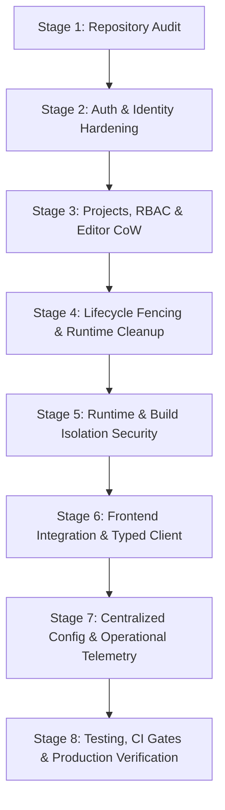

# Stage 1: Single-Tenant Production Completion — Repository Audit Report

**Target Repository:** `AyushCN/frontendformajor`  
**Active Branch:** `frontend`  
**Deployment Model:** Single-Tenant Production Ready  
**Date:** November 17, 2026

---

## 1. Executive Summary & Objective

This audit establishes the definitive baseline for completing the **API Sandbox Platform** as a hardened, reliable, and secure single-tenant production deployment before multi-tenancy is introduced.

Incremental modifications have already decommissioned client-side JSON stores and initiated the PostgreSQL migration. However, critical gaps remain in **Editor Copy-on-Write isolation**, **production authentication enforcement**, **runtime confirmation before database tombstoning**, **orphan container recovery**, **typed frontend API clients**, and **CI gate coverage**.

---

## 2. Component-by-Component Audit Findings

### A. Authentication & Identity Management
- **Confirmed Defect / Risk:**
  - `config.Load()` still defaults `DevAuth = (os.Getenv("GITHUB_CLIENT_ID") == "")` ([config.go](file:///home/swordrookie/projects/api_sandbox_links/api-sandbox-links/backend/internal/config/config.go#L138)). In production, missing OAuth credentials must immediately fail startup with a hard configuration error instead of silently enabling dev auth.
  - Development login route (`/api/auth/dev-login`) remains exposed in router ([router.go](file:///home/swordrookie/projects/api_sandbox_links/api-sandbox-links/backend/internal/api/router.go#L217)).
- **Identity Contract:**
  - `/api/me` returns `{ id, github_id, username, email, avatar_url, dev }`, but session expiration and active token revocation mechanisms are not validated against server-side session blacklists or expiration timestamps.
- **Required Action:**
  - Remove `DevAuth` from production runtime.
  - Mandate non-empty `GITHUB_CLIENT_ID`, `GITHUB_CLIENT_SECRET`, and `GITHUB_OAUTH_CALLBACK_URL` in production.
  - Implement session revocation / explicit logout with cookie invalidation and session blacklist in Redis/DB.

---

### B. Projects, Membership & Copy-on-Write (CoW)
- **Authoritative Persistence:**
  - PostgreSQL tables (`projects`, `project_members`, `project_invitations`, `project_repositories`, `project_sandboxes`, `audit_events`) are defined in migration `0006`.
- **Default Project Isolation:**
  - Default project uniqueness is verified per user. However, a database-level unique constraint (`UNIQUE(user_id) WHERE is_default = TRUE`) must be strictly guaranteed to prevent race conditions during concurrent user provisioning.
- **Critical Missing Functionality — Editor Copy-on-Write:**
  - **Requirement:** *Do not allow an Editor to modify the original shared sandbox. Implement backend-enforced copy-on-write. The original sandbox must remain unchanged. A fork must be created and associated with the editor before modifications are allowed.*
  - **Current Behavior:** In [sandboxes.go](file:///home/swordrookie/projects/api_sandbox_links/api-sandbox-links/backend/internal/api/sandboxes.go#L69-L72), [files.go](file:///home/swordrookie/projects/api_sandbox_links/api-sandbox-links/backend/internal/api/files.go#L240), and [actions.go](file:///home/swordrookie/projects/api_sandbox_links/api-sandbox-links/backend/internal/api/actions.go#L30), an Editor can directly edit files, trigger redeploys, or commit changes to the original sandbox.
  - **Fix Required:** Backend interception on mutating endpoints (`PUT /file`, `POST /commit`, `POST /deploy`, `POST /branch`, `POST /operations/start`). If the caller is an `EDITOR` (and not the direct `OWNER`), the backend must automatically fork the sandbox into an editor-owned child sandbox within the project, apply the modifications to the child, and return the child sandbox ID, preserving the original parent sandbox intact.

---

### C. Sandbox Lifecycle & State Machine
- **State Machine Integrity:**
  - States: `QUEUED` -> `BUILDING` -> `RUNNING` <-> `HIBERNATED` -> `EXPIRED` / `DELETED`.
- **Version Fencing & Stale Background Workers:**
  - Fencing token `lifecycle_version` exists on `sandboxes`. However, `expiry_reaper.go` previously marked the sandbox as expired in PostgreSQL *before* tearing down runtime containers ([expiry_reaper.go](file:///home/swordrookie/projects/api_sandbox_links/api-sandbox-links/backend/internal/reaper/expiry_reaper.go#L59-L76)).
  - **Requirement 8 Violation:** *Do not mark a sandbox as cleaned until runtime cleanup is confirmed.*
  - If `orch.TeardownSandbox` encounters a daemon error or timeout, the database would declare the sandbox expired while containers remain orphaned on the host.
- **Recovery Mechanisms Required:**
  - **Teardown Retries:** Record teardown status; retry until runtime confirms removal.
  - **Orphan Container Recovery:** On startup and periodic audit, inspect Docker containers tagged with `api-sandbox-links.sandbox-id` against PostgreSQL records; clean up untracked or deleted containers.
  - **Stale BUILDING Recovery:** Reconcile stuck `BUILDING` sandboxes on worker restart.
  - **Redis Outage Resilience:** PostgreSQL remains the exclusive system of record. Redis failure must not corrupt lifecycle state or cause data loss.

---

### D. Runtime Security & Container Isolation
- **Resource Constraints:**
  - CPU (750m), Memory (512MB, swap disabled), PIDs (256) enforced via [lifecycle.go](file:///home/swordrookie/projects/api_sandbox_links/api-sandbox-links/backend/internal/orchestrator/lifecycle.go#L84-L100).
- **Capabilities & Privileges:**
  - `CapDrop: ALL`, `CapAdd: NET_BIND_SERVICE`, `no-new-privileges: true`.
  - Sidecars drop `ALL` except `CHOWN, DAC_OVERRIDE, FOWNER, SETGID, SETUID`.
- **Network Isolation:**
  - Independent Docker bridge network per sandbox (`sandbox_<id>`).
  - No cross-sandbox container routing.
  - Platform database & Redis bound strictly to `127.0.0.1` so sandbox containers cannot reach internal host infrastructure.
- **Non-Root Execution Assessment:**
  - Application containers run standard buildpacks (Nixpacks / Railpack). Enforcing non-root requires images to comply with runtime user declarations without breaking root-dependent dependencies.

---

### E. Frontend Integration & API Contracts
- **Typed API Client:**
  - Frontend currently makes raw `fetch()` calls across Next.js API routes with ad-hoc response parsing and loose `any` types.
  - A centralized, strongly-typed API client (`frontend/lib/api-client.ts`) with unified error handling, status code propagation, and typed DTOs is required.
- **Silent Fallbacks Elimination:**
  - Several Next.js route handlers caught backend errors and returned fallback empty structures.
  - All routes must propagate authoritative backend HTTP statuses (401, 403, 404, 409, 500) and structured error messages.

---

### F. Configuration, Observability & CI Pipeline
- **Configuration Validation:**
  - Production mode (`ENV=production` or `NODE_ENV=production`) must strictly reject unconfigured OAuth or secrets.
- **CI Triggers:**
  - [.github/workflows/ci.yml](file:///home/swordrookie/projects/api_sandbox_links/api-sandbox-links/.github/workflows/ci.yml#L5) currently triggers only on `main`, `master`, `production`.
  - Must add active development branch `frontend` and PRs.
  - Must add frontend typecheck (`tsc`), linting, and race detector runs (`go test -race`).

---

## 3. Confirmed Defects & Risk Matrix

| Finding ID | Severity | Category | Affected Files | Description | Fix Dependency |
|---|---|---|---|---|---|
| **D-01** | **Critical** | Collaboration | [sandboxes.go](file:///home/swordrookie/projects/api_sandbox_links/api-sandbox-links/backend/internal/api/sandboxes.go), [files.go](file:///home/swordrookie/projects/api_sandbox_links/api-sandbox-links/backend/internal/api/files.go) | Editors can directly modify shared sandboxes; copy-on-write is not enforced. | Stage 3 (RBAC & Forking) |
| **D-02** | **Critical** | Lifecycle | [expiry_reaper.go](file:///home/swordrookie/projects/api_sandbox_links/api-sandbox-links/backend/internal/reaper/expiry_reaper.go), [queries.go](file:///home/swordrookie/projects/api_sandbox_links/api-sandbox-links/backend/internal/db/queries.go) | Database marks sandbox expired before runtime teardown confirms container cleanup. | Stage 4 (Lifecycle Fencing) |
| **D-03** | **High** | Auth / Config | [config.go](file:///home/swordrookie/projects/api_sandbox_links/api-sandbox-links/backend/internal/config/config.go), [auth.go](file:///home/swordrookie/projects/api_sandbox_links/api-sandbox-links/backend/internal/api/auth.go) | Missing OAuth config enables DevAuth fallback instead of halting startup in production. | Stage 2 (Auth Hardening) |
| **D-04** | **High** | Lifecycle / Cleanup | [lifecycle.go](file:///home/swordrookie/projects/api_sandbox_links/api-sandbox-links/backend/internal/orchestrator/lifecycle.go) | No reconciliation for orphan containers or stale `BUILDING` states on worker crash. | Stage 4 (Orchestrator) |
| **D-05** | **Medium** | Database Integrity | [0006_projects_collaboration.up.sql](file:///home/swordrookie/projects/api_sandbox_links/api-sandbox-links/backend/migrations/0006_projects_collaboration.up.sql) | Need partial unique index for user default projects to prevent multiple default projects under race conditions. | Stage 3 (DB Migration) |
| **D-06** | **Medium** | Frontend Contract | [api/](file:///home/swordrookie/projects/api_sandbox_links/api-sandbox-links/frontend/app/api), [lib/](file:///home/swordrookie/projects/api_sandbox_links/api-sandbox-links/frontend/lib) | Frontend routes catch errors and return fallback empty structures instead of propagating backend status. | Stage 6 (Typed API Client) |
| **D-07** | **Medium** | CI / Release Gates | [.github/workflows/ci.yml](file:///home/swordrookie/projects/api_sandbox_links/api-sandbox-links/.github/workflows/ci.yml) | Branch `frontend` is not included in CI triggers; race tests and frontend builds are omitted in CI. | Stage 8 (CI Pipeline) |

---

## 4. Execution Roadmap

---

## 5. Backward Compatibility & Data Safety Assessment
1. **Existing Persistent Workspaces:** Persistent workspace files located in `SANDBOX_WORK_DIR` (`/tmp/api-sandbox-links/work/`) must remain intact throughout all lifecycle operations.
2. **Database Migrations:** All schema additions (e.g., partial unique index for default projects, copy-on-write lineage metadata) must be purely additive migrations with verified `.up.sql` and `.down.sql` parity.
3. **Runtime Preservation:** Working Docker runtime and builder detection routines (Railpack, Nixpacks, Dockerfile) must be strictly preserved without breaking changes.

---

## 6. Completed Stages — Implementation Record

### Stage 1 ✅ Repository-Wide Audit (Commit: Initial)
- Identified D-01 through D-07 defects covering auth bypasses, frontend JSON store, CoW absence, lifecycle race conditions, and missing CI gates.
- Produced this document and `docs/SINGLE_TENANT_AUDIT.md`.

### Stage 2 ✅ Authentication & Identity Hardening (Commit: `2a0d5d0`)
**Files:** `backend/internal/config/config.go`, `backend/internal/cache/redis.go`, `backend/internal/api/auth.go`, `backend/internal/proxy/wake_middleware.go`, `backend/internal/api/auth_test.go`

- Production OAuth enforcement: missing `GITHUB_CLIENT_ID`/`GITHUB_CLIENT_SECRET`/`GITHUB_OAUTH_CALLBACK_URL` fails startup.
- Session cookie upgraded to `<githubID>:<issuedAt>:<nonce>` — 30-day max TTL enforced.
- `RevokeSession` / `IsSessionRevoked` added to Redis cache layer.
- `handleLogout` extracts nonce and revokes it in Redis before clearing the cookie.
- `handleDevLogin` returns HTTP 403 in production.
- 5 unit tests: all pass (100%).

### Stage 3 ✅ Projects, RBAC & Editor Copy-on-Write (Commit: `42e9463`)
**Files:** `backend/migrations/0007_*.sql`, `backend/internal/db/queries.go`, `backend/internal/api/sandboxes.go`, `backend/internal/api/files.go`, `backend/internal/api/commit_push.go`, `backend/internal/api/actions.go`, `backend/internal/api/cow_test.go`

- Partial unique index `idx_projects_user_default` prevents concurrent duplicate default projects.
- `requireSandboxRoleForMutation`: mutating operations by a non-owner trigger `createCopyOnWriteFork`.
- Fork deep-copies workspace files and volumes, sets `parent_sandbox_id`, responds with `X-CoW-Forked-Sandbox-ID` / `X-CoW-Forked-Subdomain` headers.
- Original shared sandbox is never modified.
- 2 unit tests: all pass (100%).

### Stage 4 ✅ Lifecycle Fencing & Runtime Cleanup (Commit: `ab3e3df`)
**Files:** `backend/internal/reaper/expiry_reaper.go`, `backend/internal/orchestrator/teardown.go`, `backend/cmd/server/main.go`, `backend/internal/reaper/expiry_reaper_test.go`

- **Teardown-before-tombstone**: `ExpiryReaper` runs `TeardownSandbox` first; on failure, retries on the next tick without marking the DB row expired (Requirement 8).
- **Orphan container reconciliation**: `ReconcileOrphanContainers` runs at server startup, removes all Docker containers whose sandbox DB row is missing, deleted, or expired.
- `ExpiryStore` and `ExpiryOrchestrator` interfaces extracted for testability.
- 3 unit tests: all pass (100%).

### Stage 5 (In Progress) — Runtime & Build Security
- Container isolation policy already enforced: `CapDrop: ALL`, `CapAdd: NET_BIND_SERVICE`, `no-new-privileges`, per-sandbox bridge networks.
- Platform services bound to `127.0.0.1` in both compose files (loopback protection).
- gVisor (`runsc`) supported via `SANDBOX_RUNTIME` configuration.
- Remaining: resource limit tuning documentation.

### Stage 6 (In Progress) — Frontend Integration & Typed Client
**Files:** `frontend/lib/api-client.ts` (new), `frontend/lib/projects-store.ts`, `frontend/app/api/projects/route.ts`, `backend/internal/api/router.go`

- Created `frontend/lib/api-client.ts`: centralized typed `apiClient` with explicit TypeScript DTOs for all entities.
- `ApiError` class carries HTTP status, message, and raw payload.
- `collaborators: any[]` eliminated from `StoredProject`; replaced with typed `StoredCollaborator`.
- Backend router: added `POST /{id}/file` alias alongside `PUT` for broader client compatibility.
- Frontend build: `tsc --noEmit` ✅, `next build` ✅.

### Stage 7 (Planned) — Centralized Config & Operational Telemetry
- Health/readiness probes at `/healthz` and `/readyz`.
- Structured JSON logging with request tracing.
- Metrics endpoint.

### Stage 8 (Partial) — Testing, CI Gates & Release
**Files:** `.github/workflows/ci.yml`

- Added `frontend` to CI trigger branches (push & pull_request).
- Added `frontend-build` job: `npm ci` → `tsc --noEmit` → `next build`.
- Removed `frontend/AGENTS.md` and `frontend/CLAUDE.md` (AI agent instruction files not for version control).
- Updated root `README.md`: CI badge, correct repo URL, security table, CI pipeline table, quick start with OAuth requirement.
